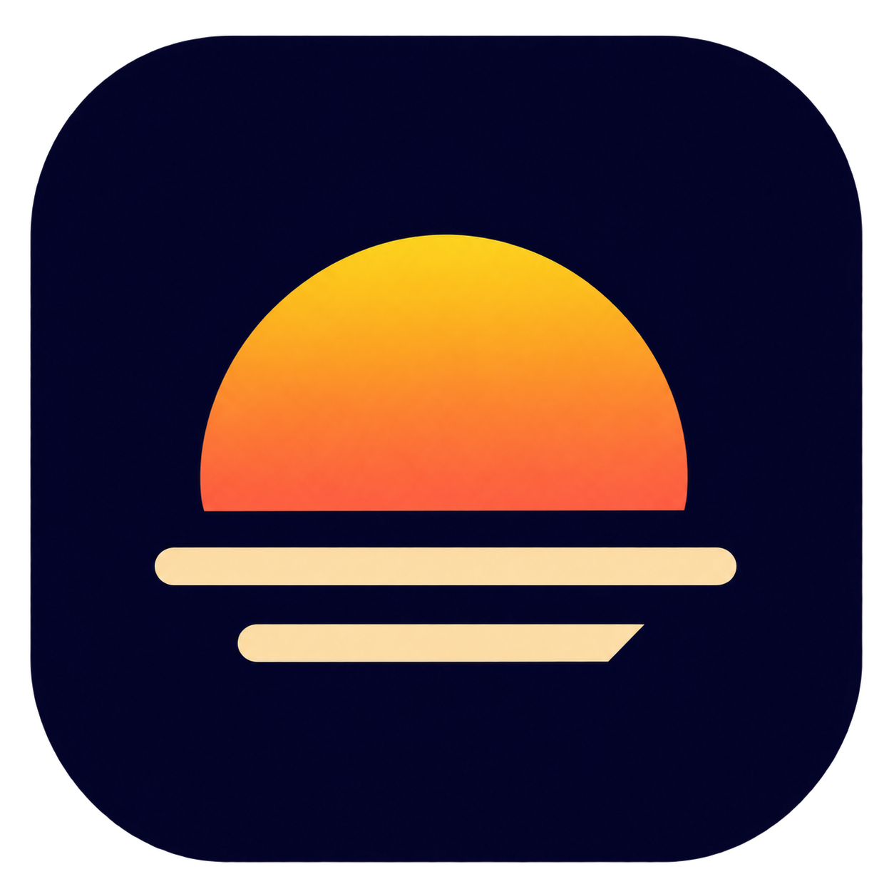

<p align="center">
  
</p>

# Luma Luma

**Make your MacBook display brighter, even when macOS brightness is already at 100%.**

Luma Luma uses available HDR headroom to boost compatible MacBook displays beyond
their normal SDR brightness. Control the extra brightness from the menu bar or
keep pressing your MacBook's brightness keys. Extra dimming and screen-edge
lighting are also included.

**macOS 14+** · **Swift 6+** · **MIT License**

[✨ Features](#-features) · [🚀 Quick start](#-quick-start) · [🎛️ User guide](docs/USAGE.md) · [🛠️ Development](docs/DEVELOPMENT.md) · [🤝 Contributing](CONTRIBUTING.md) · [☕ Support](#-support-luma-luma)

## ✨ Features

| | Feature | What it does |
| --- | --- | --- |
| ☀️ | **HDR Boost** | Uses available HDR headroom to brighten compatible displays. |
| 🌓 | **Flexible coverage** | Apply Boost to the entire display, its right half or the frontmost window. |
| 🌙 | **Eclipse** | Adds dimming below the display's normal brightness setting. |
| 💡 | **Ring Light** | Adds a screen-edge fill light with adjustable strength, width and warmth. |
| ⌨️ | **Brightness keys** | Continue from maximum macOS brightness into HDR Boost. Hold a key to repeat or use Shift–Option for fine steps. |
| 🖥️ | **Display groups** | Target all displays, the built-in display or external displays. Optionally synchronize supported Apple backlights. |
| 🔋 | **Power automation** | Turn Boost on when using a power adapter or when the battery is above a chosen level. |
| 🎚️ | **Menu bar controls** | Select and configure an effect while it is off, then enable it with one switch. |
| ⚡ | **Shortcuts** | Assign global keyboard shortcuts and use `lumaluma://` commands from macOS Shortcuts. |

Available Boost depends on the display, preset and HDR headroom reported by macOS.
The slider sets the requested effect strength. Luma Luma shows when HDR is
preparing, active or unavailable. [Display compatibility and limits](docs/USAGE.md#-display-compatibility)

## 🚀 Quick start

### Requirements

- macOS 14 or newer.
- Swift 6.0 or newer, provided by Xcode or the Xcode Command Line Tools, for building from source.
- An HDR-capable display for Boost. Eclipse and Ring Light can be used on SDR displays.

### Download and install

Download the latest `LumaLuma-<version>-macos-universal.zip` and its `.sha256`
file from the release page. The Universal app supports Apple Silicon and Intel
Macs. [Download Luma Luma](https://github.com/ill-yes/luma-luma/releases/latest)

Expand the ZIP, move **Luma Luma.app** to **Applications** and open it. Releases use
ad-hoc signing. macOS may require explicit approval on first launch. [Installation and updates](docs/USAGE.md#-installation-and-updates)

### Build and launch

From the repository directory, run

```sh
./scripts/build-app.sh
open 'dist/Luma Luma.app'
```

The script creates a release app for the current Mac's architecture and signs it
locally with an ad-hoc signature. Move the app to **Applications** before enabling
**Open at login**. [Build details](docs/DEVELOPMENT.md#-build-and-packaging)

### Use an effect

1. Click the sunrise icon in the menu bar.
2. Select **Boost**, **Eclipse** or **Ring Light** and adjust the controls.
3. Turn on the switch to apply the selected effect.

Changing the selected effect while the switch is on applies the new selection.
Right-click the menu bar icon to toggle the selected effect. **Settings…** opens
display, power and keyboard preferences.

### Enable the MacBook brightness keys

Open **Settings… → Shortcuts**, enable **Use display brightness keys** and grant
Luma Luma the requested macOS access. At maximum native brightness, another
**Brighter** press starts Boost. **Darker** steps back into normal macOS brightness.
Use **Shift–Option** for finer adjustments. [Permission setup and key behavior](docs/USAGE.md#-macbook-brightness-keys)

## 📚 Documentation

| Guide | Contents |
| --- | --- |
| [🎛️ User guide](docs/USAGE.md) | Effects, display compatibility, brightness keys, power rules, macOS Shortcuts and troubleshooting. |
| [🛠️ Development](docs/DEVELOPMENT.md) | Toolchain, repository layout, rendering, helper lifecycle, tests and packaging. |
| [🧪 Validation](docs/VALIDATION.md) | Automated coverage, observed MacBook results and hardware checks still to run. |
| [🤝 Contributing](CONTRIBUTING.md) | Local checks, useful issue reports and contribution guidance. |

## 🛠️ Development

Run the automated checks with

```sh
./scripts/test-hdr.sh
```

The macOS CI workflow runs the same checks and builds the app. Local build outputs
and temporary test data belong in the ignored `.build/` and `dist/` directories.
[Developer guide](docs/DEVELOPMENT.md)

## ☕ Support Luma Luma

Support Luma Luma's continued development on Buy Me a Coffee.

[](https://buymeacoffee.com/ill_yes)

## 📄 License

Luma Luma is open source under the **MIT License**. A copy is included in every
packaged app at `Contents/Resources/LICENSE`. [Read the license](LICENSE)
