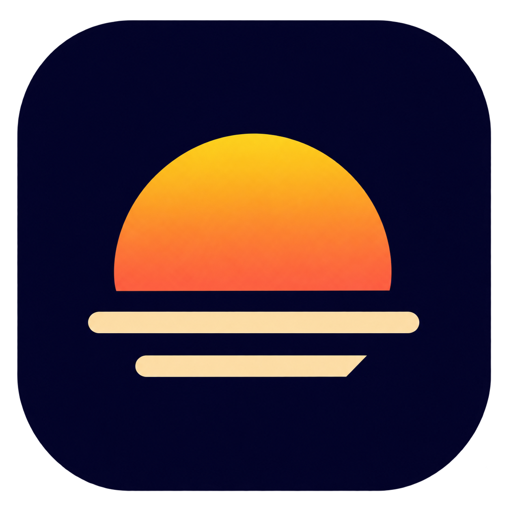

<p align="center">
  
</p>

<a id="luma-luma"></a>

<h1 align="center">Luma Luma</h1>

<p align="center"><strong>A little more daylight. Right from your menu bar.</strong></p>

<p align="center">
  <a href="https://github.com/ill-yes/luma-luma/actions/workflows/ci.yml"></a>
  <a href="https://github.com/ill-yes/luma-luma/releases/latest"></a>
  <a href="https://github.com/ill-yes/luma-luma/releases"></a>
  <a href="https://github.com/ill-yes/luma-luma/commits/main"></a>
</p>

<p align="center">
  <a href="#installation"></a>
  <a href="docs/DEVELOPMENT.md#-local-setup"></a>
  <a href="LICENSE"></a>
</p>

<p align="center">
  <a href="docs/README.md"></a>
  <a href="https://buymeacoffee.com/ill_yes"></a>
</p>

<p align="center">
  <a href="#installation">🚀 Download for macOS</a> · <a href="#features">✨ Features</a> · <a href="docs/USAGE.md">🎛️ User guide</a> · <a href="#status">🧪 Status</a> · <a href="#documentation">📚 Documentation</a> · <a href="#support">☕ Support</a>
</p>

**Make your MacBook display brighter, even when macOS brightness is already at 100%.**

Luma Luma is a native macOS menu bar app that uses available HDR headroom to
boost compatible displays beyond their normal SDR brightness. Control the extra
brightness from the menu bar or keep pressing your MacBook's brightness keys.
Extra dimming and screen-edge lighting are also included.

<a id="features"></a>

## ✨ Features

| Feature | What it does |
| --- | --- |
| ☀️ **HDR Boost** | Uses available HDR headroom to brighten compatible displays. |
| 🎚️ **Brightness slider** | Move from macOS brightness into HDR Boost on a supported display. |
| 🌓 **Flexible coverage** | Apply Boost to the entire display, its right half or the frontmost window. |
| 🌙 **Eclipse** | Adds dimming below the display's normal brightness setting. |
| 💡 **Ring Light** | Adds a screen-edge fill light with adjustable strength, width and warmth. |
| ⌨️ **Brightness keys** | Continue from maximum macOS brightness into HDR Boost. Hold a key to repeat or use Shift–Option for fine steps. |
| 🖥️ **Display profiles** | Choose a display group and customize effect values and participation for each monitor. |
| 🌤️ **Auto-Boost** | Use the built-in light sensor to add HDR Boost in bright surroundings at maximum macOS brightness. |
| 🔋 **Power automation** | Use the power adapter or a battery threshold to control automatic Boost. |
| 🔍 **Display diagnostics** | Inspect the requested Boost, applied gain and HDR headroom for each display. |
| ⚡ **Shortcuts** | Assign global keyboard shortcuts and use `lumaluma://` commands from macOS Shortcuts. |

Available Boost depends on the display, preset and HDR headroom reported by macOS.
Luma Luma shows when HDR is preparing, active or unavailable.
[Display compatibility and limits](docs/USAGE.md#-display-compatibility)

<a id="installation"></a>
<a id="quick-start"></a>

## 🚀 Quick start

### Requirements

- macOS 14 or newer.
- An HDR-capable display for Boost. Eclipse and Ring Light can be used on SDR displays.
- Swift 6.0 or newer, provided by Xcode or the Xcode Command Line Tools, **only when building from source**.

### Download and install

1. Open the [latest release](https://github.com/ill-yes/luma-luma/releases/latest)
   and download the DMG and its matching `.dmg.sha256` file. Choose
   `macos-arm64.dmg` for Apple silicon or `macos-x86_64.dmg` for Intel.
2. Verify the disk image from the download directory with `shasum -a 256 -c`
   followed by the name of the downloaded `.dmg.sha256` file.
3. Open the DMG, drag **Luma Luma.app** to **Applications** and open the installed
   copy. Move the app to **Applications** before enabling **Open at login**.

Releases use ad-hoc signing. macOS may require explicit approval on first launch.
Older releases provide a Universal ZIP for both architectures.
[Installation, first-launch approval and updates](docs/USAGE.md#-installation-and-updates)

<a id="first-steps"></a>

### Use an effect

1. Click the sunrise icon in the menu bar.
2. Select **Boost**, **Eclipse** or **Ring Light**, then choose a display to adjust.
3. Turn on the switch to apply the effect to the participating displays. In the
   **Boost** tab, dragging past the **100%** macOS mark starts HDR Boost directly
   on the chosen display.

Changing the selected effect while the switch is on applies the new selection.
Right-click the menu bar icon to toggle the selected effect. **Settings…** opens
display, power and keyboard preferences. **Diagnostics…** opens per-display
status and a copyable report. [Menu bar controls](docs/USAGE.md#-menu-bar-controls)

### Enable the MacBook brightness keys

Open **Settings… → Shortcuts** and enable **Use display brightness keys**. If the
option shows **Accessibility permission required**, choose
**Request Accessibility Access…** and grant access in
**System Settings → Privacy & Security → Accessibility**. On German-language
macOS 27, the pane is named **Gerätesteuerung und Datenzugriff**. Return to Luma
Luma; **Keyboard access active** confirms that the app connected to the keys.

At maximum native brightness, another **Brighter** press starts Boost. **Darker**
steps back into normal macOS brightness. Use **Shift–Option** for finer
adjustments. [Permission setup and key behavior](docs/USAGE.md#-macbook-brightness-keys)

<a id="status"></a>

## 🧪 Compatibility and status

| Area | What to expect |
| --- | --- |
| **Display support** | Boost requires available HDR headroom. macOS presets, power and temperature affect the result; Eclipse and Ring Light also work on SDR displays. |
| **Manual effects** | With the power rule set to **Manual** and Auto-Boost off, the app restores the last manual effect and on/off state. [Startup behavior](docs/USAGE.md#-startup-and-automation) |
| **Software checks** | CI tests and packages on native Apple silicon and Intel runners. The build badge links to the current workflow; it does not establish complete hardware compatibility. |
| **Hardware evidence** | Recorded MacBook observations and remaining external-display, physical-key, sleep and lock checks are documented separately. [Validation](docs/VALIDATION.md) |

<a id="documentation"></a>

## 📚 Documentation

Start with what you want to do. The [documentation home](docs/README.md) also
groups troubleshooting and development paths.

| I want to… | Start here |
| --- | --- |
| Install or update the app | [🚀 Installation and updates](docs/USAGE.md#-installation-and-updates) |
| Adjust brightness, effects or display profiles | [🎛️ User guide](docs/USAGE.md) |
| Set up brightness keys or automation | [⌨️ Brightness keys](docs/USAGE.md#-macbook-brightness-keys) · [⚙️ Startup and automation](docs/USAGE.md#-startup-and-automation) |
| Understand a status message | [🧭 Status and troubleshooting](docs/USAGE.md#-status-and-troubleshooting) |
| Build, test or contribute | [🛠️ Development](docs/DEVELOPMENT.md) · [🤝 Contributing](CONTRIBUTING.md) |
| Review what has been validated | [🧪 Validation](docs/VALIDATION.md) |

<a id="development"></a>

## 🛠️ Development

<a id="build-and-launch"></a>

From the repository directory, build and launch with

```sh
./scripts/build-app.sh
open 'dist/Luma Luma.app'
```

The script creates a release app for the current Mac's architecture and signs it
locally with an ad-hoc signature. [Build details](docs/DEVELOPMENT.md#-build-and-packaging)

Run the automated checks with

```sh
./scripts/test-hdr.sh
```

The **Build and test** workflow runs the shared build on native Apple silicon
and Intel runners. To try a development snapshot, open the newest successful
`main` run and download the DMG and matching checksum for your Mac from
**Artifacts**. [Build and test runs](https://github.com/ill-yes/luma-luma/actions/workflows/ci.yml)

Local build outputs and temporary test data belong in the ignored `.build/` and
`dist/` directories. See the [developer guide](docs/DEVELOPMENT.md) and
[contribution guidance](CONTRIBUTING.md).

<a id="license"></a>

## 📄 License

Luma Luma is open source under the **MIT License**. A copy is included in every
packaged app at `Contents/Resources/LICENSE`. [Read the license](LICENSE)

<a id="support"></a>

## ☕ Support Luma Luma

Support Luma Luma's continued development on Buy Me a Coffee.

[](https://buymeacoffee.com/ill_yes)
